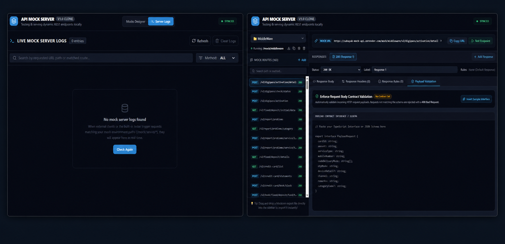

# API Mock Server

A self-hosted mock API workspace for designing isolated environments, creating flexible REST routes, testing payload validation, and watching live request logs in a dark, high-contrast UI.

It is built with Express, React, Vite, and Tailwind CSS, with a pluggable storage layer: **local file** (zero-config default) or **Cloud Firestore**.

## Screenshots



The collage combines the main Mocks Designer view and the Server Logs view.

## What It Does

- Create multiple mock environments with their own URL prefixes.
- Define mock routes with dynamic params like `/users/:id` or wildcard matching.
- Configure multiple responses per route, each with status, headers, body, and matching rules.
- Simulate latency to test client timeout and loading-state behavior.
- Validate request bodies against pasted TypeScript interfaces or JSON-schema-like objects.
- Inspect live request logs with headers, query params, response details, and latency.
- Persist configurations to a local file (default) or Firestore, so your setup survives restarts.

## Key Features

- Multi-environment mock design with isolated route trees.
- Route duplication, reordering, import/export (Mockoon, Postman, OpenAPI), and global headers.
- Response editor with JSON body formatting and header editing.
- Rule-based response matching for headers, query params, body values, and route params.
- Template variables in responses/headers: `{{uuid}}`, `{{query name}}`, `{{body user.id}}`, `{{header x-token}}`, `{{param id}}`, `{{randomInt 1 100}}`, `{{date iso}}`.
- Automatic CORS handling for `OPTIONS` requests (correct origin/credentials pairing).
- Built-in request logger with filter/search controls and sensitive-header redaction.
- **Operation-based saving**: only the entities you actually changed are sent and written — editing one endpoint never uploads the whole config.

## Architecture

The server is split into small, independently testable modules (no more 900-line monolith):

```
server.ts                        thin entry point: config -> storage -> store -> HTTP
src/lib/ops.ts                   shared op protocol: buildOps() diff + applyOps() reducer
src/lib/api.ts                   small frontend REST client
src/lib/slugify.ts               URL-safe slugs
src/server/
  config.ts                      env/config parsing (dotenv works locally)
  state.ts                       Store: in-memory snapshot + op application + touched-path tracking
  logs.ts                        ring buffer + header/query redaction
  api.ts                         HTTP layer: /api/environments, /api/logs, /mock/:envId/*
  mock/
    matcher.ts                   route pattern matching (:params, wildcards)
    rules.ts                     rule engine (25 operators, AND/OR)
    validation.ts                TS-interface / JSON-schema body validation
    templates.ts                 {{...}} response templating
    responder.ts                 pure mock resolution (method match, rules, validation, latency)
  storage/
    index.ts                     StorageBackend interface + touched-path types
    fileStorage.ts               local JSON file (atomic writes) - default, zero-config
    firestoreStorage.ts          hierarchical Firestore docs; writes only touched documents
src/components/...               React UI (Sidebar, Route/Response editors, LogViewer, Settings)
```

### How saving works

1. The UI keeps the last saved snapshot and the current working state.
2. On **Save Changes**, `buildOps(saved, current)` computes a minimal list of operations (`response.upsert`, `route.delete`, `env.reorder`, …).
3. Those operations are POSTed to `/api/environments`. The server applies the same pure `applyOps()` reducer, updates the in-memory snapshot, and persists **only the touched entities** to the configured backend.
4. You get a synchronous `{ success, applied }` acknowledgement, so a failed save is surfaced in the UI instead of silently queued.

Editing a single endpoint's response body therefore produces a payload of exactly one `response.upsert` — nothing else crosses the wire or is written to storage.

## Tech Stack

- Frontend: React 19, Vite, Tailwind CSS, Lucide Icons
- Backend: Node.js, Express, tsx, esbuild
- Storage: local JSON file (default) or Cloud Firestore (firebase-admin)

## Project Structure

- [`server.ts`](server.ts): thin entry point and wiring.
- [`src/server/`](src/server/): API, state, logging, mock engine, and storage backends.
- [`src/lib/ops.ts`](src/lib/ops.ts): shared operation protocol (diff + reducer).
- [`src/lib/api.ts`](src/lib/api.ts): frontend REST client.
- [`src/App.tsx`](src/App.tsx): main app shell, tabs, save flow, and state.
- [`src/components/`](src/components): Sidebar, route editor, response editor, settings, logs UI.
- [`src/types.ts`](src/types.ts): shared TypeScript models.
- [`test/`](test): unit tests for the op protocol and the mock engine.

## Local Setup

### Prerequisites

- Node.js 18 or newer
- npm

### Install

```bash
npm install
```

### Start Development Server

```bash
npm run dev
```

Open `http://localhost:3000`. Configuration persists to `data/mock-config.json` automatically — no Firebase needed.

### Build For Production

```bash
npm run build
npm start
```

### Tests

```bash
npm test
```

## Configuration

All environment variables are optional. Without any configuration the app uses local file storage.

| Variable | Default | Purpose |
| --- | --- | --- |
| `PORT` | `3000` | Port the server listens on |
| `HOST` | `0.0.0.0` | Bind interface |
| `APP_URL` | *(empty)* | Public URL used for generated mock URLs |
| `FIREBASE_SERVICE_ACCOUNT_JSON` | *(empty)* | When set, use Firestore; when unset, use the local file |
| `FIRESTORE_DATABASE_ID` | *(empty)* | Named Firestore database (empty = default) |
| `DATA_FILE` | `<project>/data/mock-config.json` | Local file storage path |
| `DISABLE_HMR` | *(empty)* | Set `true` to disable Vite HMR / file watching |

Example for Firestore:

```bash
FIREBASE_SERVICE_ACCOUNT_JSON='{"type":"service_account", "...":"..."}'
FIRESTORE_DATABASE_ID=""
```

## Storage

- **Local file (default).** The server reads and writes a single JSON document atomically. The app runs out of the box and restarts reload your configuration.
- **Firestore.** When `FIREBASE_SERVICE_ACCOUNT_JSON` is set, the server uses the Admin SDK with a hierarchical document layout (`config/mock-environments/environments/{id}/routes/{id}/responses/{id}`). Only touched documents are written. Existing data in this layout is read back automatically.

Important behavior (both backends):

- The app starts with whatever the backend holds (or an empty list).
- Nothing is written until you click **Save Changes**.
- Deletes cascade: removing an environment removes its routes and responses from storage.
- If Firestore cannot be initialized, the server falls back to local file storage and logs a warning.

## Firestore Rules

[`firestore.rules`](firestore.rules) denies direct client access (`allow read, write: if false`). The server uses the Admin SDK service account, which bypasses rules, so only the server can read or write the configuration. **Deploy these rules** if you switch a project to Firestore storage.

## How To Use

1. Create an environment.
2. Add a route and choose an HTTP method.
3. Set the endpoint path relative to the environment prefix.
4. Add one or more responses.
5. Configure headers, body, status, latency, and optional matching rules.
6. Click **Save Changes** — only what changed is persisted.
7. Test the endpoint through `/mock/:envId/...`.

## Troubleshooting

### Save fails with Firestore errors

- Confirm the Firebase service account belongs to the same project as the Firestore database.
- If you use the default database, leave `FIRESTORE_DATABASE_ID` empty.
- Check that Firestore is enabled for the project.

### Mock route not found

- Confirm the environment ID or slug in the URL.
- Make sure the route path matches after the environment prefix is stripped.
- Check the HTTP method on the route.

### Changes reappear after refresh

- You probably edited local state but did not click **Save Changes**.
- Refreshing reloads the last persisted state.

## Deployment

This app needs a Node.js runtime because it uses an Express server.

1. Build the app with `npm run build`.
2. Start the server with `npm start`.
3. Optionally set the Firebase service account JSON to use Firestore; otherwise it persists to the local `DATA_FILE`.
